# Komponenter

Dette katalog registrerer elektroniske input- og outputkomponenter, der bruges sammen
med boards i Arduino Playground: displays, sensorer, aktuatorer, kommunikations-
moduler og andre komponenter.

Hver fysisk komponenttype får sit eget stabile id og en mappe med:

- identifikation og relevante tekniske data;
- pinout, spændingsniveauer og tilslutning;
- eventuelle adresser, biblioteker og kendte faldgruber;
- links til alle sketches i repoet, som bruger komponenten.

## Registrerede komponenter

| Foto | Komponent | Type | Interface | Produkt-id | Sketches |
| --- | --- | --- | --- | --- | --- |
| – | [LCD1602 med PCF8574T](lcd1602-i2c-pcf8574/README.md) | Output/display | I²C | – | [`lcd1602_i2c_demo`](../sketches/arduino-uno-r4-wifi/lcd1602_i2c_demo) |
| 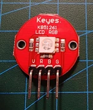 | [RGB LED](keyestudio-ks0032-rgb-led/README.md) | Output/lys | Digital/PWM | KS0032 | – |
| 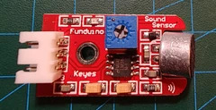 | [Mikrofon](keyestudio-ks0035-microphone/README.md) | Input/lyd | Analog | KS0035 | – |
| 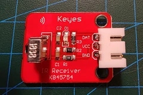 | [IR-modtager](keyestudio-ks0026-ir-receiver/README.md) | Input/IR | Digital | KS0026 | – |
| 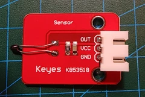 | [Analog temperatursensor](keyestudio-ks0033-thermistor/README.md) | Input/temperatur | Analog | KS0033 | – |
| 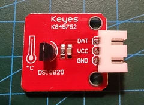 | [DS18B20-temperatursensor](keyestudio-ks0023-ds18b20/README.md) | Input/temperatur | 1-Wire | KS0023 | – |
| 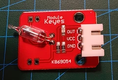 | [Tiltsensor](keyestudio-ks0025-tilt/README.md) | Input/orientering | Digital | KS0025 | – |
| 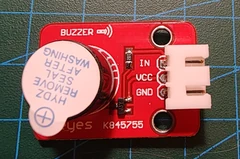 | [Aktiv buzzer](keyestudio-ks0018-active-buzzer/README.md) | Output/lyd | Digital | KS0018 | – |
| 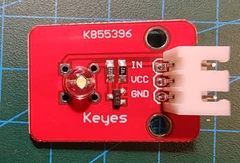 | [Straw-hat LED-modul](keyes-k855396-straw-hat-led/README.md) | Output/lys | Digital/PWM | K855396 | – |
| 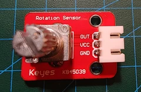 | [Analog rotationssensor](keyestudio-ks0014-analog-rotation/README.md) | Input/position | Analog | KS0014 | – |
| 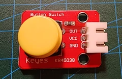 | [Trykknap](keyestudio-ks0029-push-button/README.md) | Input/kontakt | Digital | KS0029 | – |
| 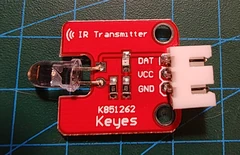 | [IR-sender](keyestudio-ks0027-ir-transmitter/README.md) | Output/IR | Digital/PWM | KS0027 | – |
| 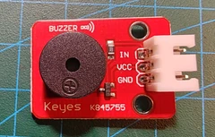 | [Passiv buzzer](keyestudio-ks0019-passive-buzzer/README.md) | Output/lyd | Digital/tone | KS0019 | – |
| 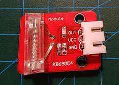 | [Knock-sensor](keyestudio-ks0024-knock/README.md) | Input/slag | Digital | KS0024 | – |
| 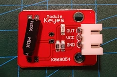 | [Reed switch](keyestudio-ks0038-reed-switch/README.md) | Input/magnet | Digital | KS0038 | – |
| 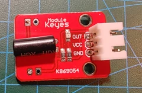 | [Vibrationssensor](keyestudio-ks0037-vibration/README.md) | Input/vibration | Digital | KS0037 | – |
| 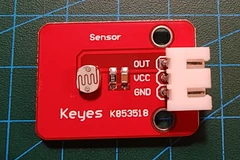 | [Fotomodstandssensor](keyestudio-ks0028-photocell/README.md) | Input/lys | Analog | KS0028 | – |
| 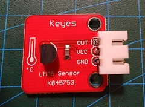 | [LM35-temperatursensor](keyestudio-ks0022-lm35/README.md) | Input/temperatur | Analog | KS0022 | – |
| 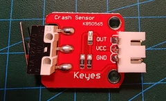 | [Collision-/endestopsensor](keyestudio-ks0021-collision/README.md) | Input/kontakt | Digital | KS0021 | – |

## Navngivning

Nye komponenter placeres i `components/<component-id>/`, hvor `component-id` skrives med små
bogstaver og bindestreger, eksempelvis `bme280-temperature-humidity-pressure`.
Profilen opdateres, hver gang komponenten bruges i en ny sketch.
