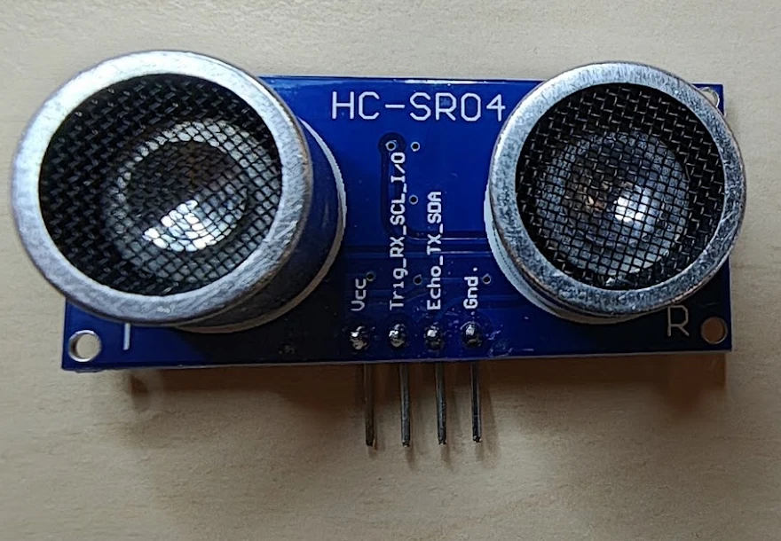
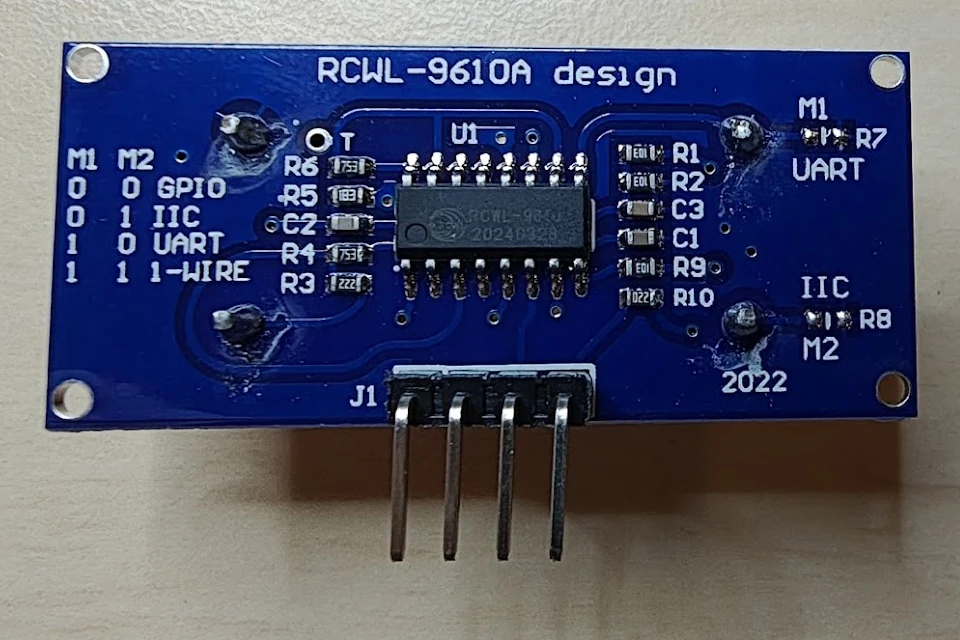

# HC-SR04 ultralydssensor med RCWL-9610A

## Identifikation

| Felt | Værdi |
| --- | --- |
| Frontmærkning | HC-SR04 |
| Printdesign | RCWL-9610A design, 2022 |
| Type | Ultralydsafstandssensor med separat sender og modtager |
| Akustisk frekvens | 40 kHz |
| Typisk måleområde | 2–400 cm |
| Typisk opløsning | 3 mm |
| Forsyning | 2,8–5,5 V; 3,3 V eller 5 V bruges normalt |
| Interfaces | GPIO, I²C, UART eller 1-Wire |

Denne 2022-variant ligner en klassisk HC-SR04, men RCWL-9610A-kredsen giver
flere interfacevalg. I standardtilstanden er modulet kompatibelt med den
almindelige Trig/Echo-styring.

## Pinout

| Pin | GPIO | UART | I²C | 1-Wire |
| --- | --- | --- | --- | --- |
| `VCC` | Forsyning | Forsyning | Forsyning | Forsyning |
| `Trig-RX-SCL-I/O` | `Trig` | `RX` | `SCL` | Data |
| `Echo-TX-SDA` | `Echo` | `TX` | `SDA` | Ikke brugt |
| `GND` | Stel | Stel | Stel | Stel |

Signalniveauerne følger modulets forsyning. Ved 5 V-forsyning skal `Echo`
derfor tilpasses, hvis controllerens indgang ikke er 5 V-tolerant. En enkel
spændingsdeler kan bruges i GPIO-tilstand; alternativt kan modulet forsynes
med 3,3 V.

## Valg af interface

Modepadsene `M1`/`R7` og `M2`/`R8` på bagsiden bestemmer interfacet. `0` er en
åben forbindelse, og `1` er en loddet bro eller monteret modstand.

| M1 | M2 | Interface |
| --- | --- | --- |
| 0 | 0 | GPIO / klassisk HC-SR04 |
| 0 | 1 | I²C |
| 1 | 0 | UART |
| 1 | 1 | 1-Wire |

Begge modepads ser åbne ud på det fotograferede modul, så det er konfigureret
til GPIO. Afbryd forsyningen, før loddekonfigurationen ændres.

## Måling i GPIO-tilstand

Send en puls på mindst 10 µs til `Trig`. Modulet udsender derefter otte
40 kHz-pulser og holder `Echo` høj i den tid, lydens tur til objektet og tilbage
tager. Afstanden kan tilnærmes som `echo_tid_i_µs / 58` centimeter. Vent mindst
60 ms mellem målinger for at undgå, at ekkoer fra forrige måling forstyrrer.

Der er ingen sketches til komponenten i repoet endnu.

## Kilder

- [RCWL-9610-datablad fra Wuxi Richen IoT Technology](https://make.net.za/wp-content/datasheets/RCWL-9610%20Datasheet%20v1.0%20-%20Original.pdf)
- [SparkFun HC-SR04-R-datablad](https://cdn.sparkfun.com/assets/6/7/a/d/1/Ultrasonic_Ranging_Module_HC-SR04-R__SEN-28798.pdf)
