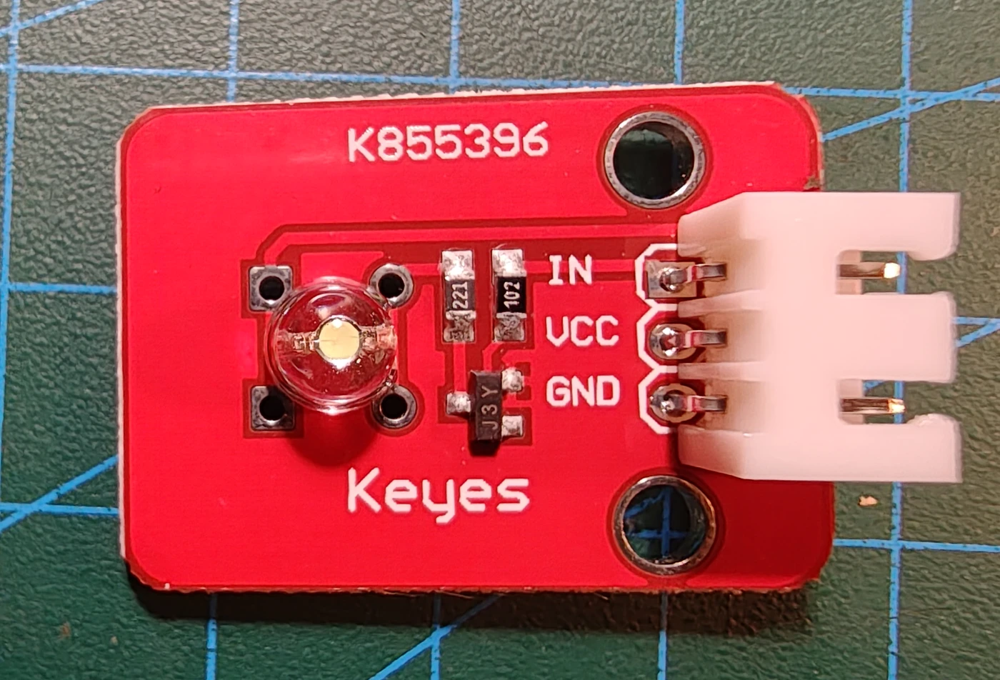
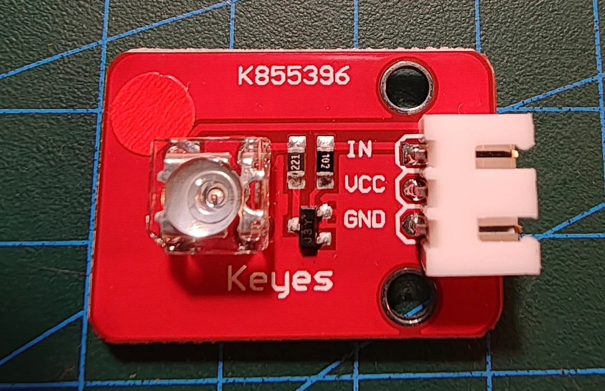

# Keyes K855396 straw-hat LED-modul

## Identifikation

| Felt | Værdi |
| --- | --- |
| Boardkode | K855396 |
| Type | Straw-hat LED-modul |
| Interface | `IN`, `VCC`, `GND` |
| Forsyning | 3,3–5 V |
| Output | Digital on/off |

Begge fotos viser samme boardkode, `K855396`, og samme LED-modul fra forskellige
vinkler. Det er et almindeligt LED-modul og ikke en laser eller en pulssensor.

## Sikkerhed og tilslutning

`IN` forbindes til en digital udgang. Lysstyrken kan også styres med PWM, hvis
den valgte pin understøtter det. Ingen sketches endnu.

## Kilde

- [Keyes K855396 Straw Hat LED Sensor Module](https://www.easytechnology.gr/electronics/atmel-arduino/keyes-straw-hat-led-sensor-module-with-3pin-dupont-cable-for-arduino-k855396)
