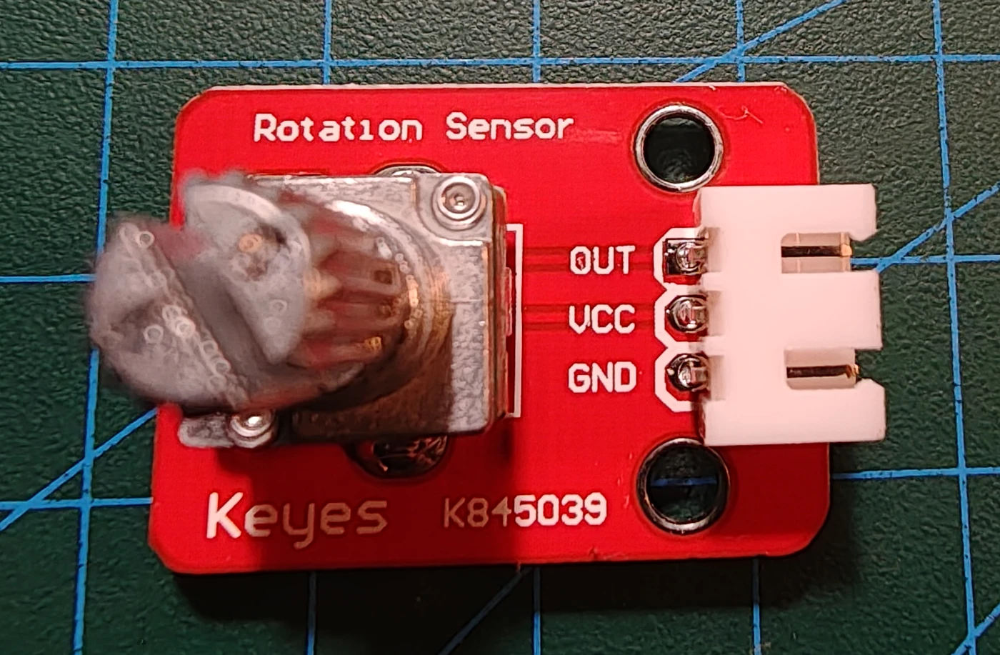

# Keyestudio KS0014 analog rotationssensor

## Identifikation

| Felt | Værdi |
| --- | --- |
| Produkt-id | KS0014 |
| Type | Drejepotentiometer |
| Interface | `OUT`, `VCC`, `GND` |
| Output | Analog spænding afhængig af akselposition |
| Forsyning | 5 V |

Dette er et analogt drejepotentiometer, ikke KS0013 rotary encoder.

## Tilslutning

`OUT` forbindes til en analog indgang. ADC-værdien kan skaleres til procent,
vinkel eller et applikationsspecifikt interval. Ingen sketches endnu.

## Kilde

- [Keyestudio KS0014 Analog Rotation Sensor](https://wiki.keyestudio.com/Ks0014_keyestudio_Analog_Rotation_Sensor)
