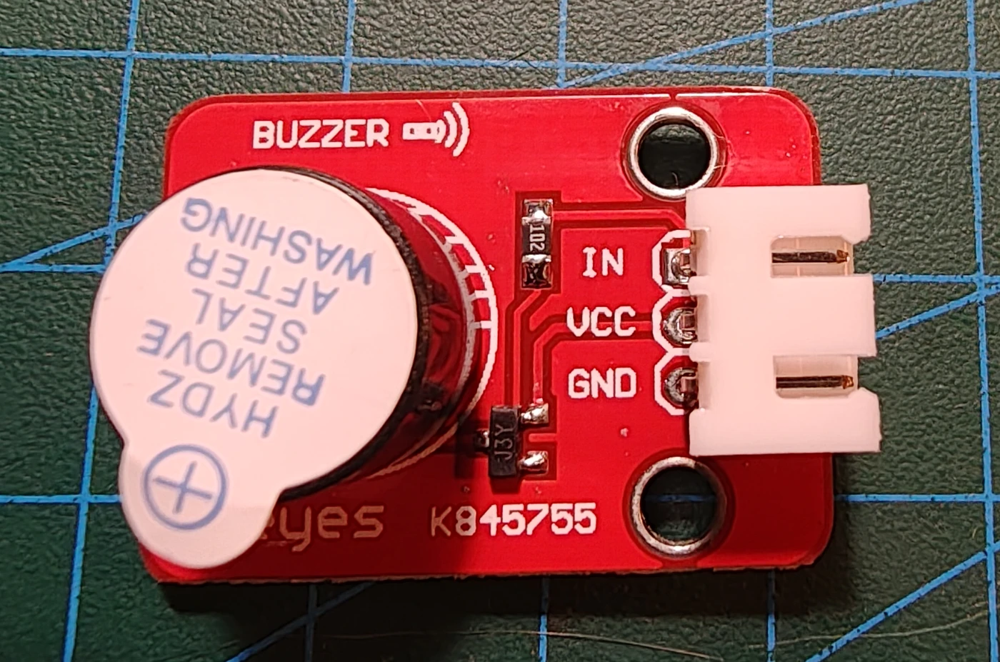

# Keyestudio KS0018 aktiv buzzer

## Identifikation

| Felt | Værdi |
| --- | --- |
| Produkt-id | KS0018 |
| Type | Aktiv buzzer med intern oscillator |
| Interface | `IN`, `VCC`, `GND` |
| Styring | Digital on/off |

Den aktive buzzer giver en fast tone ved aktivering. Den lukkede lydgiver med
mærkat adskiller den fra KS0019 passive buzzer.

## Tilslutning

Forbind `IN` til en digital udgang og forsyn efter modulets silketryk. Brug ikke
PWM-tonegenerering som til en passiv buzzer. Ingen sketches endnu.

## Kilde

- [Keyestudio KS0018 Digital Buzzer Module](https://wiki.keyestudio.com/Ks0018_keyestudio_Digital_Buzzer_Module)
