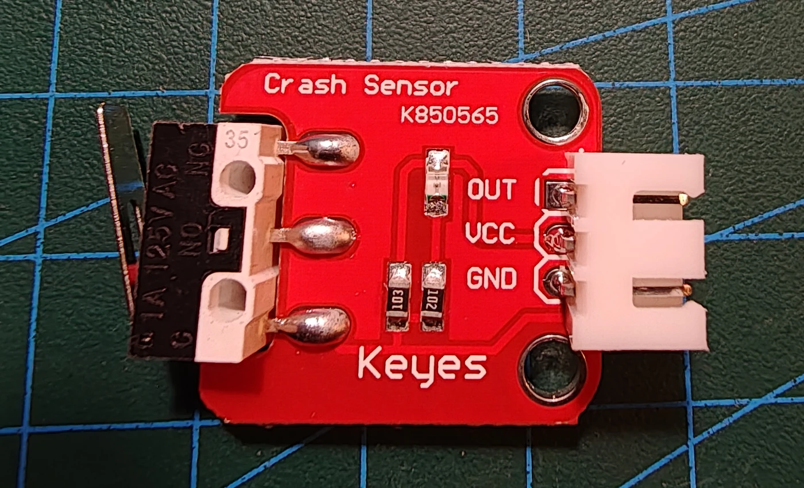

# Keyestudio KS0021 collision-/endestopsensor

## Identifikation

| Felt | Værdi |
| --- | --- |
| Produkt-id | KS0021 |
| Type | Mekanisk snap-action mikrokontakt |
| Interface | `OUT`, `VCC`, `GND` |
| Output | Digitalt, aktivt LOW ved aktivering |

Modulet er mærket “Crash Sensor” og kan bruges som kollisionsføler eller
endestop på en mekanisk konstruktion.

## Tilslutning

`OUT` forbindes til en digital indgang. Kontrollér aktivt niveau og anvend
debounce, hvis ét fysisk tryk kun må tælle én gang. Ingen sketches endnu.

## Kilde

- [Keyestudio KS0021 Collision Sensor](https://wiki.keyestudio.com/Ks0021_keyestudio_Collision_Sensor)
