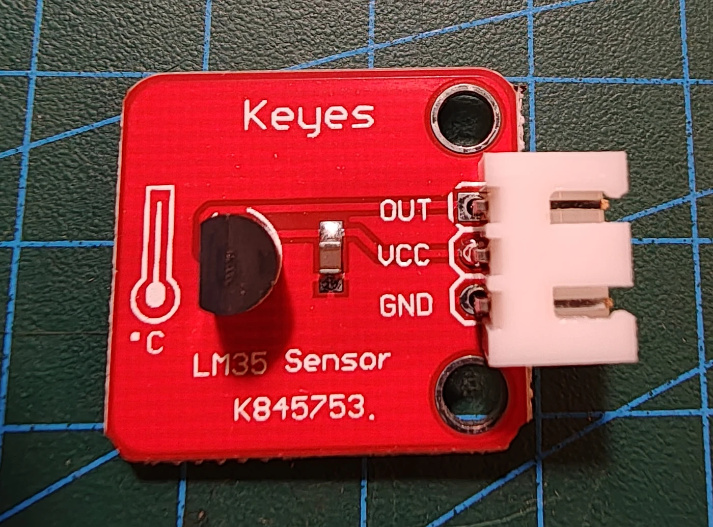

# Keyestudio KS0022 LM35-temperatursensor

## Identifikation

| Felt | Værdi |
| --- | --- |
| Produkt-id | KS0022 |
| Sensor | LM35 lineær analog temperatursensor |
| Interface | `OUT`, `VCC`, `GND` |
| Følsomhed | 10 mV/°C |
| Dokumenteret modulområde | Ca. 0–100 °C |

## Tilslutning

`OUT` forbindes til en analog indgang. Temperaturen beregnes ud fra målt
spænding og ADC-reference; brug den faktiske reference for bedre nøjagtighed.
Ingen sketches i repoet endnu.

## Kilde

- [Keyestudio KS0022 LM35 Linear Temperature Sensor](https://wiki.keyestudio.com/Ks0022_keyestudio_LM35_Linear_Temperature_Sensor)
