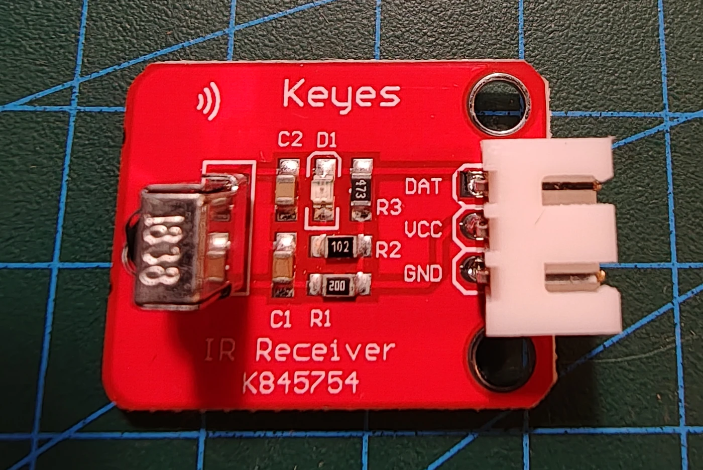

# Keyestudio KS0026 digital IR-modtager

## Identifikation

| Felt | Værdi |
| --- | --- |
| Produkt-id | KS0026 |
| Type | Demodulerende infrarød modtager |
| Interface | `OUT`, `VCC`, `GND` |
| Signal | Digitalt, typisk 38 kHz fjernbetjeningsbærebølge |
| Forsyning | 5 V |

Modulet modtager kodede IR-signaler fra fjernbetjeninger eller KS0027.

## Tilslutning

`OUT` forbindes til en digital indgang. Brug et IR-bibliotek med den valgte pins
interrupt/timer-begrænsninger. Modulet har ingen sketches i repoet endnu.

## Kilde

- [Keyestudio KS0026 Digital IR Receiver](https://wiki.keyestudio.com/Ks0026_keyestudio_Digital_IR_Receiver_Module)
