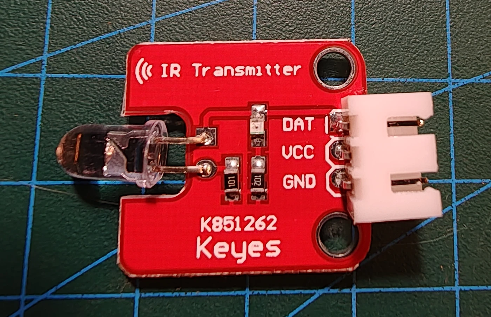

# Keyestudio KS0027 digital IR-sender

## Identifikation

| Felt | Værdi |
| --- | --- |
| Produkt-id | KS0027 |
| Type | Infrarød LED-sender |
| Interface | `OUT`, `VCC`, `GND` |
| Forsyning | 3–5 V |
| Typisk bærebølge | 38 kHz |

Modulet sender fjernbetjeningsprotokoller til blandt andet KS0026 IR-modtageren.

## Tilslutning

`OUT` forbindes til en timer/PWM-egnet digital pin. Pinvalg afhænger af det
anvendte IR-bibliotek og board. IR kræver fri eller reflekteret sigtelinje. Ingen sketches endnu.

## Kilde

- [Keyestudio KS0027 Digital IR Transmitter](https://wiki.keyestudio.com/Ks0027_keyestudio_Digital_IR_Transmitter_Module)
