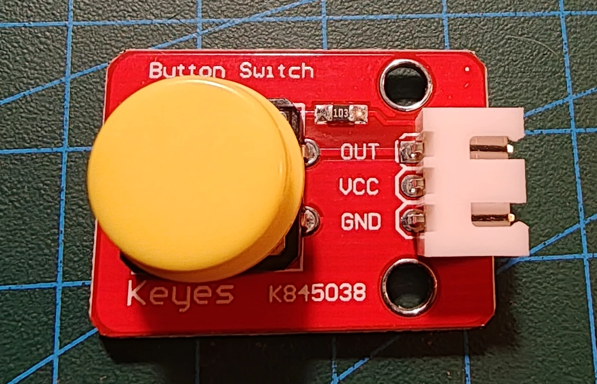

# Keyestudio KS0029 trykknapmodul

## Identifikation

| Felt | Værdi |
| --- | --- |
| Produkt-id | KS0029 |
| Type | Momentan trykknap |
| Interface | `OUT`, `VCC`, `GND` |
| Output | Digitalt |
| Forsyning | 3,3–5 V |

## Tilslutning og hensyn

`OUT` forbindes til en digital indgang. Kontrollér aktivt niveau i den konkrete
sketch og anvend software-debounce. Modulet har ingen sketches i repoet endnu.

## Kilde

- [Keyestudio KS0029 Digital Push Button](https://wiki.keyestudio.com/Ks0029_keyestudio_Digital_Push_Button)
