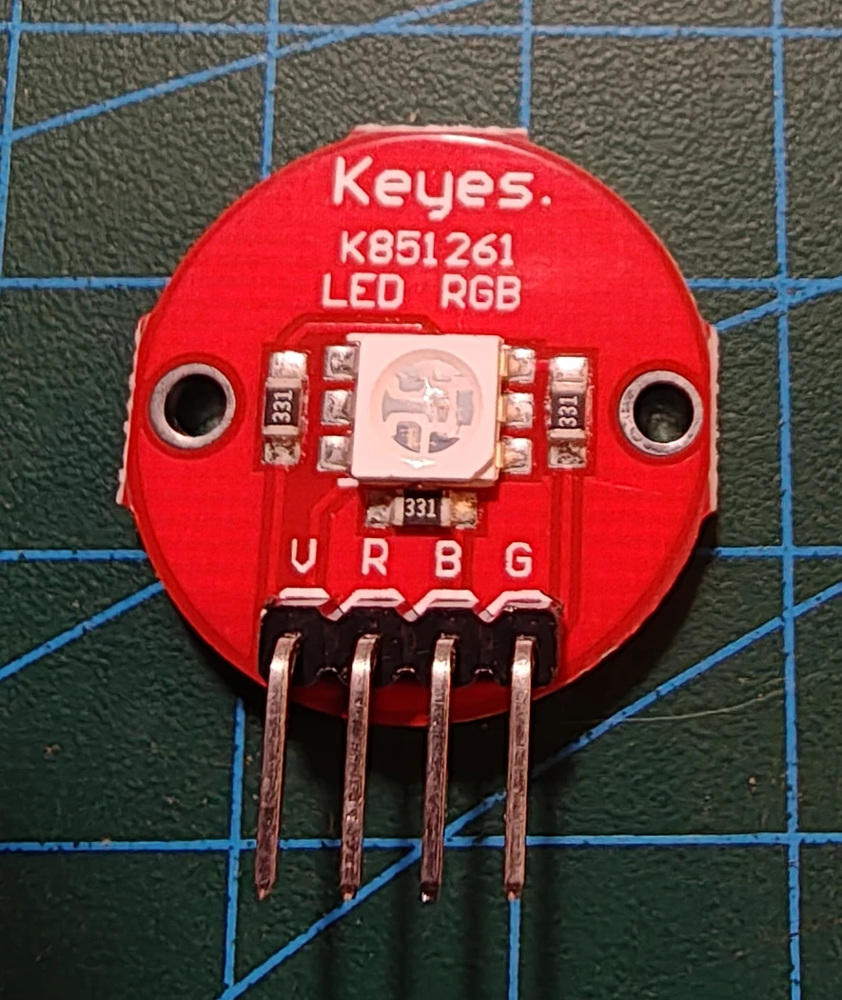

# Keyestudio KS0032 RGB LED-modul

## Identifikation

| Felt | Værdi |
| --- | --- |
| Producent | Keyestudio / Keyes |
| Produkt-id | KS0032 |
| Type | RGB-output med tre LED-kanaler |
| Interface | Tre digitale/PWM-signaler og fælles forsyning |
| Forsyning | 5 V |

Modulet er det runde board øverst til venstre på referencefotoet. Den indbyggede
RGB-LED blander rød, grøn og blå ved at styre kanalerne separat.

## Tilslutning og hensyn

Forbind den fælles pin efter boardets silketryk og R, G og B til PWM-egnede pins.
Kontrollér polariteten før tilslutning; logikken kan være inverteret ved fælles
anode. Modulet har ingen sketches i repoet endnu.

## Kilde

- [Keyestudio KS0032 RGB LED Module](https://wiki.keyestudio.com/Ks0032_keyestudio_RGB_LED_Module)
