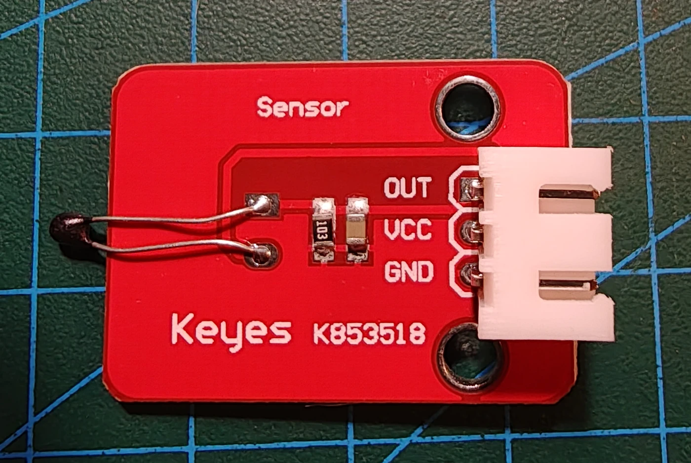

# Keyestudio KS0033 analog temperatursensor

## Identifikation

| Felt | Værdi |
| --- | --- |
| Produkt-id | KS0033 |
| Type | NTC-termistorbaseret temperatursensor |
| Interface | `OUT`, `VCC`, `GND` |
| Output | Analog spænding fra spændingsdeler |
| Forsyning | 5 V |

Modulet er kendetegnet ved den lille sorte termistorperle på to lange ben. Det
skal ikke forveksles med reed-, tilt- eller Hall-sensorer.

## Tilslutning og hensyn

`OUT` forbindes til en analog indgang. Temperaturen beregnes fra ADC-værdien og
termistorens modstandsmodel; nøjagtige målinger kræver kalibrering. Ingen sketches endnu.

## Kilde

- [Keyestudio KS0033 Analog Temperature Sensor](https://wiki.keyestudio.com/Ks0033_keyestudio_Analog_Temperature_Sensor)
