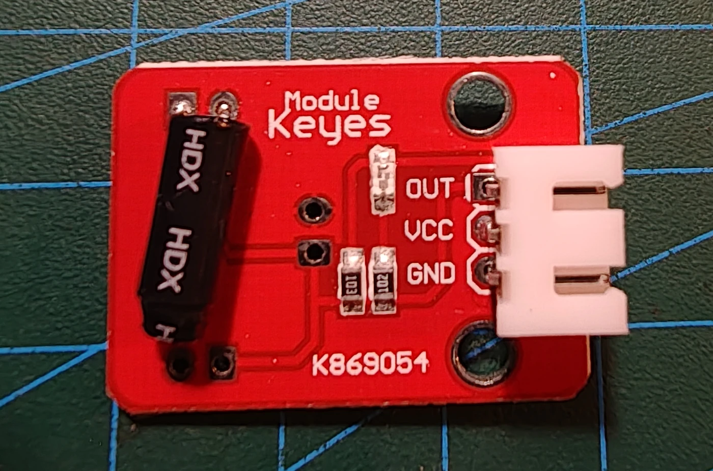

# Keyestudio KS0038 reed switch

## Identifikation

| Felt | Værdi |
| --- | --- |
| Produkt-id | KS0038 |
| Type | Magnetisk reed-kontakt i glasrør |
| Interface | `OUT`, `VCC`, `GND` |
| Forsyning | 3,3–5 V |
| Typisk detektionsafstand | Op til ca. 10 mm, afhængigt af magneten |

Dette er modulet med det sorte glasrør mærket `MKA14103`/tilsvarende. Kontakten
skifter, når en magnet føres tæt på.

## Tilslutning

`OUT` forbindes til en digital indgang. Glaskapslen er skrøbelig, og kontakten
kan kræve debounce. Ingen sketches endnu.

## Kilde

- [Keyestudio KS0038 Reed Switch Module](https://wiki.keyestudio.com/Ks0038_keyestudio_Reed_Switch_Module)
