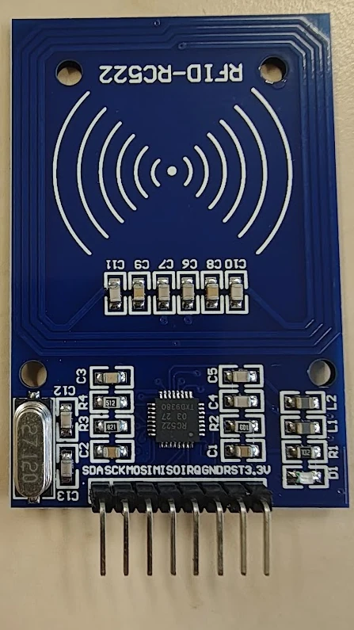
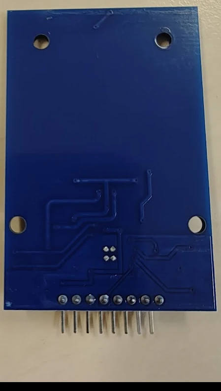

# RFID-RC522 RFID-læser

## Identifikation

| Felt | Værdi |
| --- | --- |
| Boardmærkning | RFID-RC522 |
| Reader-IC | NXP MFRC522 |
| Type | RFID-reader/writer med integreret printantenne |
| Radiofrekvens | 13,56 MHz |
| Understøttelse | ISO/IEC 14443 A, MIFARE og NTAG |
| Værtsinterface på modulet | SPI |
| Forsyning og logikniveau | 3,3 V |

## Pinout

| Pin på modulet | SPI-funktion | Bemærkning |
| --- | --- | --- |
| `SDA` | `SS` / `CS` | Chip-select; er ikke I²C-data på dette modul |
| `SCK` | `SCK` | SPI-clock |
| `MOSI` | `MOSI` | Data fra controller til modulet |
| `MISO` | `MISO` | Data fra modulet til controlleren |
| `IRQ` | Interrupt | Valgfri; de fleste Arduino-eksempler bruger den ikke |
| `GND` | Stel | Fælles stel med controlleren |
| `RST` | Reset/power-down | Digital styrepin |
| `3.3V` | Forsyning | Må ikke forbindes til 5 V |

## Tilslutning og hensyn

Modulet forsynes fra 3,3 V. MFRC522's digitale signaler er også 3,3 V-logik;
brug derfor level-shifting på signaler fra en 5 V-controller, medmindre boardets
dokumentation udtrykkeligt siger, at de valgte pins arbejder ved 3,3 V.

`SDA`-navnet på printet er misvisende ved SPI-brug: pinnen er modulets
chip-select og kaldes typisk `SS`, `CS` eller `NSS` i biblioteker. Modulet har
en integreret antenne og en 27,12 MHz-krystal. Det er beregnet til kort og tags
ved 13,56 MHz; det er ikke kompatibelt med 125 kHz-RFID-tags.

Der er ingen sketches til komponenten i repoet endnu.

## Kilder

- [NXP MFRC522-produktoversigt](https://www.nxp.com/products/rfid-nfc/nfc-hf/nfc-readers/standard-performance-mifare-and-ntag-frontend:MFRC52202HN1)
- [NXP MFRC522-datablad](https://www.nxp.com/docs/en/data-sheet/MFRC522.pdf)
